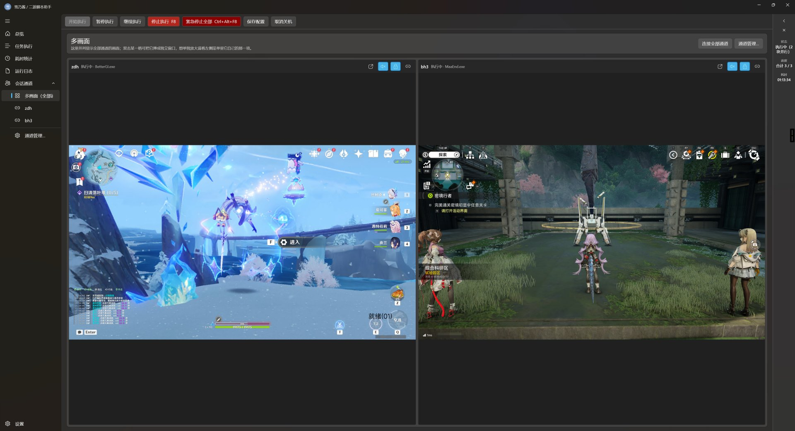
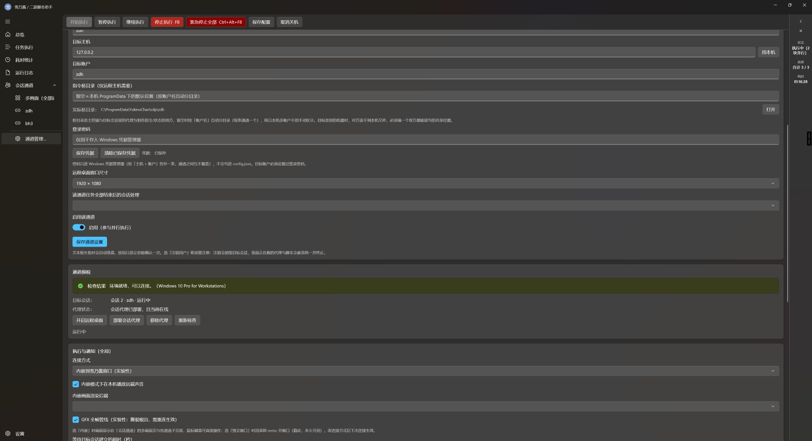
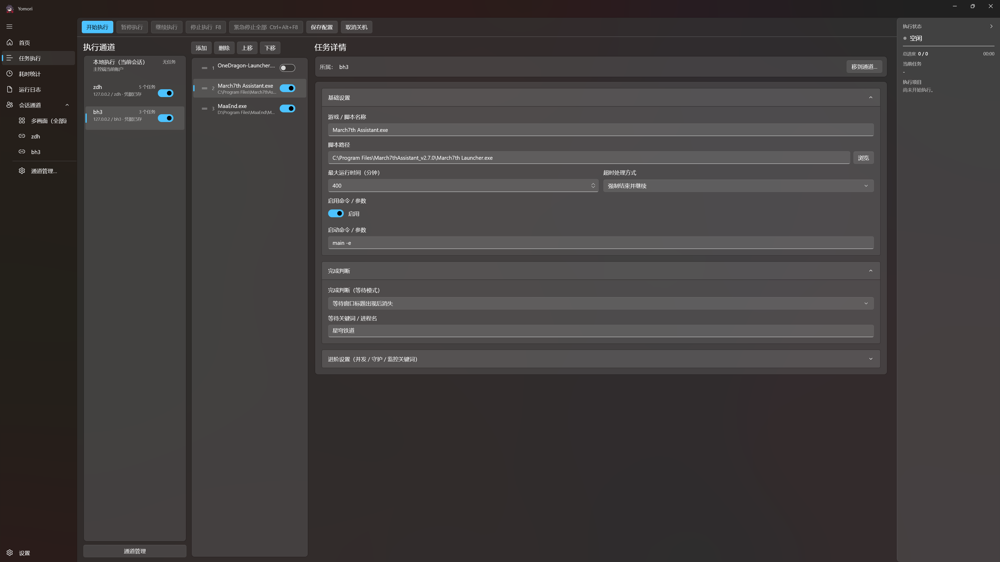

# Yomori · 二游脚本统合管理器

Windows 桌面应用，使用 C# 与 WinUI 3（Windows App SDK）开发。当前版本 **v2.2.0**。

用途：统一管理多个 Windows 账户下的每日自动化任务 —— 配置执行环境、按通道编排任务、监控执行状态，
并在任务结束后按配置完成收尾（保持会话 / 断开 / 注销 / 关机）。



---

## 1. 背景与设计目标

常见的游戏自动化工具（如 BetterGI、MaaEnd）通过模拟点击与键鼠注入实现操作，依赖桌面前台窗口与单一鼠标焦点。
这带来两个固有约束：

- **同一桌面内无法并行执行。** 两个实例同时运行时会相互干扰，实际只能串行排队。
- **执行期间桌面处于被占用状态。** 鼠标与窗口焦点受自动化程序控制，操作者无法同时进行其他工作。

多账户场景还伴随另外三项成本：账户切换耗时（注销、登录、等待桌面加载）、执行状态不可见、结束后无人收尾。

本程序不以"多开进程"作为解决方案 —— 进程隔离无法解决焦点争用。其基础是**会话隔离**：每个账户运行在独立的
Windows 会话中，每个会话拥有各自的桌面、鼠标与输入焦点。因此多个通道可以真正并行，各通道的输入事件也不会落到
其他会话的窗口上。

并行数量仍受目标系统的会话数限制，见第 2 节。

---

## 2. 前置条件：多会话支持

通道功能依赖目标机器允许**同时存在多个交互式会话**。该条件不满足时，第二条通道会顶替第一条的桌面，通道功能无法正常使用。

程序本身不改变 Windows 的会话能力，只向**已存在的会话**下发任务。

| 目标 | 是否需额外配置 |
|---|---|
| 另一台机器（跨机器通道） | 不需要。各机器使用各自的会话，天然并行 |
| 本机其他账户 | 需要。Windows 客户端版默认仅允许一个交互式会话 |
| Windows Server | 不需要。配置远程桌面会话主机即可支持多会话 |

本机需要多会话时，须安装额外的多用户支持组件（社区常用开源工具 **RDP Wrapper**）。
安装与配置步骤（下载、安装、`rdpwrap.ini` 适配、创建账户、连接本机）参见：

> ### [本地远程多用户后台挂机指南](https://www.bettergi.com/tutorial/rdp.html)
>
> 第三方文档（BetterGI 文档站），与本项目无关。该工具修改 Windows 终端服务的行为：
> 可能因系统更新失效、可能被杀毒软件拦截，且涉及许可条款 —— 使用风险由使用者自行承担。

**验证方法**：切换至目标账户登录一次后返回，同时连接两条通道。两个画面均正常刷新表示多会话已生效；
若仅有一个画面正常、另一个将当前桌面顶回锁屏，则多会话未生效。

---

## 3. 功能界面

### 3.1 通道管理：配置执行环境



一条**会话通道**由以下要素构成：目标机器、目标账户、该账户的凭据、一条专用指令通道、一路画面连接。

配置通道的目的在于建立一套独立的桌面环境。独立账户对应独立会话，独立会话对应独立的鼠标焦点与前台窗口；
多个通道即多套桌面，可同时运行。

配置流程共四步：

1. 开启页面顶部的总开关「**在目标账户会话中执行任务**」（关闭后所有任务回到本机执行）；
2. 新建通道，填写通道名称、**目标主机**（本机其他账户填 `127.0.0.1`，另一台机器填 IP，可带端口）、**目标账户**；
3. 在密码框中输入该账户密码，点击「**保存凭据**」。密码仅存入 Windows 凭据管理器，不写入 `config.json`；
4. 点击「**部署会话代理**」（一次性操作，需管理员权限），然后点击「重新预检」，直至无阻塞项。

> **会话代理的部署原因**：Windows 上跨会话启动进程只能由目标会话一侧发起。程序会将自身复制到
> `C:\ProgramData\Yomori\agent\`（所有账户可读），并在公共启动目录创建快捷方式，目标账户下次登录时代理被拉起并常驻，
> 等待指令。**部署完成后需注销目标账户并重新连接一次** —— 已处于登录状态的会话不会自动出现代理。

预检区域显示以下检查结果：账户是否存在、远程桌面是否开启、代理是否在线。目标账户至少成功登录过一次，代理才能被拉起。

### 3.2 任务执行：编排任务



页面分三栏，依次对应"选择执行方 → 确定顺序 → 配置细节"：

| 栏 | 内容 |
|---|---|
| 左：执行通道 | 「本地执行（当前会话）」及各条通道 |
| 中：该通道的任务 | 序号即执行顺序，支持上移、下移、添加、删除 |
| 右：任务详情 | 启动命令与参数、工作目录、最大运行时间、超时处理方式、完成判定 |

「本地执行」固定为第一项，也是新建任务的默认归属，以避免任务在未选定通道时被下发到其他账户。

**并行规则：通道之间并行，通道内部串行。** 多条通道各自执行任务队列，互不等待；同一条通道内的任务按顺序依次执行。
一次最多并行 8 条通道，超出部分会被截断，并明确列出未执行的通道。

### 3.3 多画面：执行监控

即本文开头的截图。远程桌面不以独立 `mstsc` 窗口呈现，而是由 **FreeRDP 将画面内嵌至程序窗口**（原生渲染，非截图推流），
鼠标与键盘可直接操作，账户切换无需离开当前窗口。

- 每页 2×2 四格；通道数超过四条时底部提供翻页（同屏八路的管理开销不划算）；
- 双击某一格可弹为独立窗口，支持移至其他显示器；
- 单条通道另有独立页面：画面占满，下方附该通道的事件列表。

窗口右侧为状态面板，显示当前状态、进度与耗时，可收起为窄条或整列关闭。

---

## 4. 快速上手

| 步骤 | 位置 | 操作 |
|---|---|---|
| 1 | 系统层面 | 启用多会话支持（见第 2 节；跨机器通道可跳过） |
| 2 | 会话通道 → 通道管理… | 配置通道、保存凭据、部署代理、完成预检 |
| 3 | 任务执行 | 选择通道、添加任务、填写启动命令与超时设置 |
| 4 | 顶栏「开始执行」 | 通过多画面监控执行，结束后按配置收尾 |

收尾行为可配置：任务全部结束后自动关机（带可取消倒计时）、异常报告、开机自启。
点击窗口关闭按钮不会直接结束程序，默认询问「收进状态栏」或「退出」；收进状态栏时任务与画面继续运行，
可通过托盘图标恢复主界面。

---

## 5. 功能概览

| 能力 | 说明 |
|---|---|
| 任务编排 | 按序执行脚本（exe / bat / py 等）；支持并发组（全部完成 / 任一完成即继续）、超时处理、按窗口标题或进程名判定完成 |
| 会话通道 | 任务分发至不同账户或不同机器并行执行；每个通道为独立 Windows 会话，互不争用焦点；通道间并行、通道内串行，上限 8 条 |
| 内嵌画面 | FreeRDP 原生内嵌，鼠标键盘直接操作；多路同屏（2×2 分页）；支持独立窗口；分辨率可选 |
| 运行反馈 | 状态面板、运行日志、按来源区分的脚本耗时统计 |
| 凭据存储 | 密码仅保存于 Windows 凭据管理器；导出配置时剥离密码字段 |
| 收尾 | 自动关机（可取消）、异常报告、开机自启 |
| 其他 | 单实例运行、托盘常驻、`F8` 停止执行、`Ctrl+Alt+F8` 紧急停止、跟随系统主题、高 DPI 多显示器支持 |

界面采用原生 Fluent 设计：Mica 背景、自定义标题栏、浅色 / 深色跟随系统、高 DPI 下不模糊。

---

## 6. 运行环境

| 项目 | 要求 |
|---|---|
| 操作系统 | Windows 10 1809（build 17763）及以上，推荐 Windows 11；x64 |
| 运行时 | 绿色版需 .NET 8 桌面运行时；自包含版无需安装 |
| 权限 | 主控端需管理员权限（部署代理、开启远程桌面）；被控端代理以普通权限运行 |
| 远程桌面 | 目标账户**必须设置登录密码**；目标机需能接受 RDP 连接 |

## 7. 构建

```bash
cd winui3
dotnet restore
dotnet build -c Release -p:Platform=x64
```

产物为 `unpackaged` 模式，双击即可运行，无需 MSIX 安装或侧载：

```text
winui3/src/Yomori.App/bin/x64/Release/Yomori.exe
```

两点注意事项：

- **内嵌画面依赖原生层 `ycn_rdp.dll`**（FreeRDP 桥接层）。该文件为构建产物，未纳入版本库，全新克隆后需自行编译一次，
  步骤见 [winui3/README.md](winui3/README.md) 第三节。
- **程序运行期间不要直接执行 `dotnet build`**：exe 被占用会导致资源包 `Yomori.pri` 未更新，启动后切换页面可能崩溃。
  须先完全退出程序再构建。

---

## 8. 文档

| 内容 | 位置 |
|---|---|
| 完整技术说明：环境、构建、目录结构、实现原理 | [winui3/README.md](winui3/README.md) |
| 使用手册：界面说明、逐字段配置、故障排查 | [winui3/USER_GUIDE.md](winui3/USER_GUIDE.md) |
| 变更记录 | [winui3/CHANGELOG.md](winui3/CHANGELOG.md) |
| 设计文档与计划书 | [winui3/docs/](winui3/docs/) |
| Python / PySide6 版本移植记录 | [winui3/docs/migration-from-python.md](winui3/docs/migration-from-python.md) |
| 已知限制与后续计划 | [winui3/docs/known-limits-and-roadmap.md](winui3/docs/known-limits-and-roadmap.md) |

---

## 9. 已知限制

- **本机多账户的并行数量取决于 Windows 版本与授权。** 多数客户端版同时仅允许一个交互式会话，连接后当前桌面会被锁定。
  建议在无人值守场景使用；需要同时操作本机时，请使用跨机器通道，或按第 2 节启用多会话支持。
- **目标账户必须设置密码**，空密码账户无法通过 RDP 登录。
- **部署代理后需注销并重新连接一次**，否则会话中不存在代理，表现为"连接成功但任务不执行"。
- **一条通道对应一个账户**，两条通道共用同一账户会争用同一会话。
- **一次最多 8 条通道并行**，超出部分会被截断并说明原因。
- **断线告警最长约 90 秒**：心跳判定保留 90 秒启动宽限期，以避免将正常登录过程误报为失联。
- **收进状态栏不等于任务隔离**：仍为同一进程，仅窗口不可见。退出程序时本地任务会被清理，远程通道的任务在被控机上继续运行。

---

## 10. 仓库结构

```text
winui3/       C# / WinUI 3 主工程（Yomori.sln、src/、docs/、tools/）
assets/       应用图标（icon.ico）与 logo 源图 —— 同时作为程序定位根目录的标记，请勿删除
config.json   运行时配置（任务、会话通道、窗口几何）
docs/         文档截图
```

数据目录（`config.json` / `logs/` / `runtime_stats/`）均位于程序根目录下。程序通过「同级目录存在 `config.json` 或 `assets/`」
向上回溯定位根目录，因此 `assets/` 需随程序一同分发。

---

## 11. 旧版本

仓库早期包含一套 Python + PySide6 实现（v1.0 RC1），已于 2026-09-28 移除；当前 `winui3/` 为唯一主线。
如需旧代码，可从移除前的 Git 历史中获取。

## 12. 许可证

本程序以 [MIT](LICENSE) 许可证发布。

程序在分发时包含下列第三方组件：FreeRDP、WinPR（FreeRDP 的 Windows 平台抽象层）、OpenSSL（以上均为 Apache License 2.0），以及 zlib、cJSON（zlib License / MIT）；托管层为 .NET 8 运行时、Windows App SDK 与若干 NuGet 包（均为 MIT）。

各组件的完整版权与许可条款见安装目录或发布包内的 `THIRD-PARTY-NOTICES.txt`，也可在程序内「设置 → 关于 → 开源许可」查看清单。

组件清单维护于 `winui3/third_party/components.json`，是程序界面与打包脚本共用的唯一数据源；`THIRD-PARTY-NOTICES.txt` 由 `winui3/tools/gen_third_party_notices.py` 在打包时依据该清单与构建所用 vcpkg 的许可证原文生成，不随仓库静态维护。
